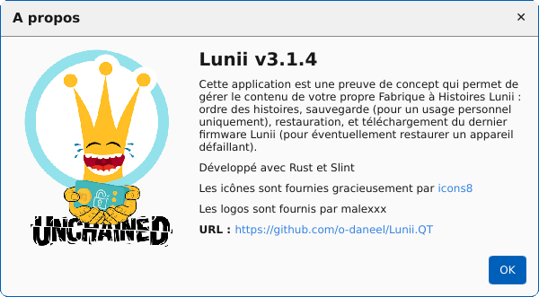
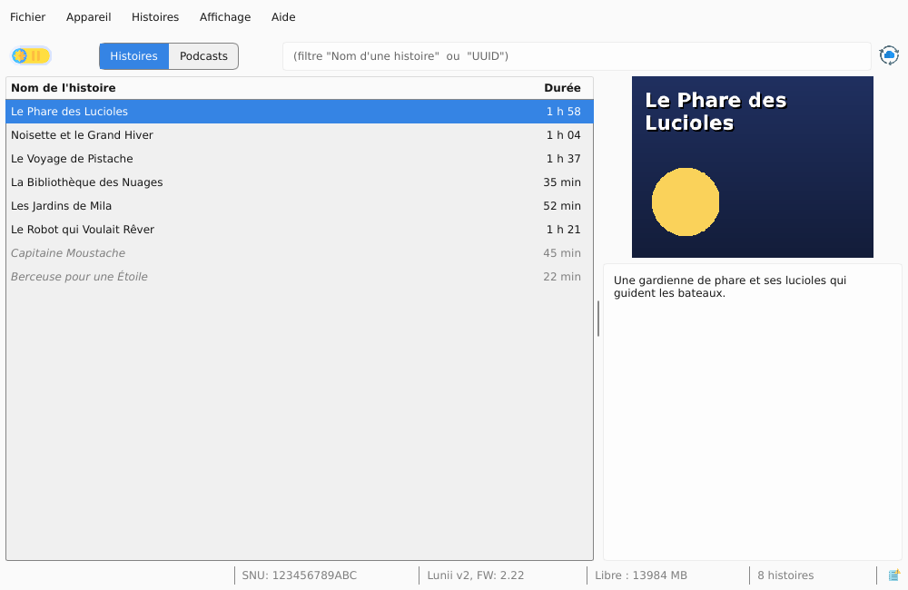
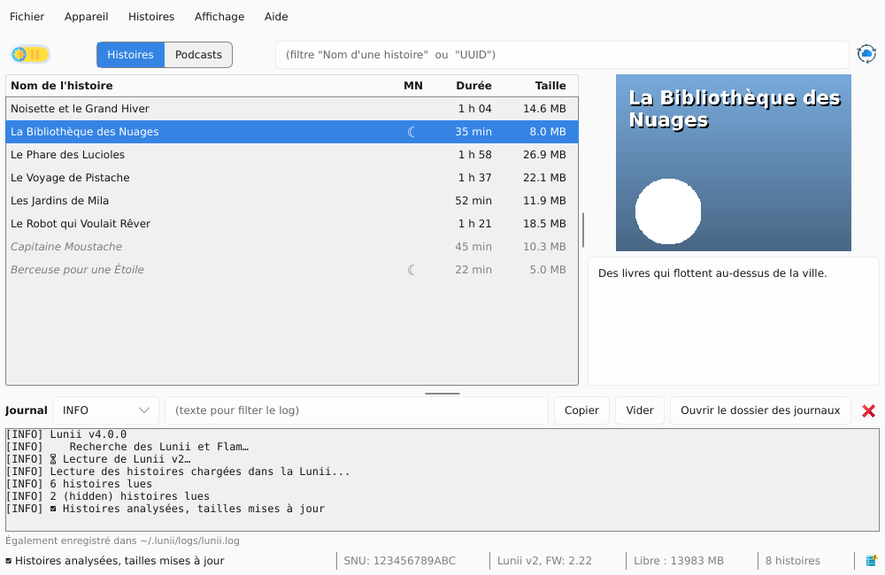
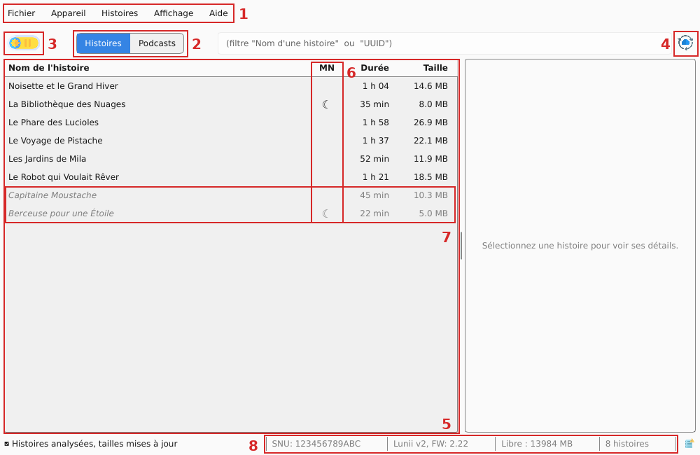
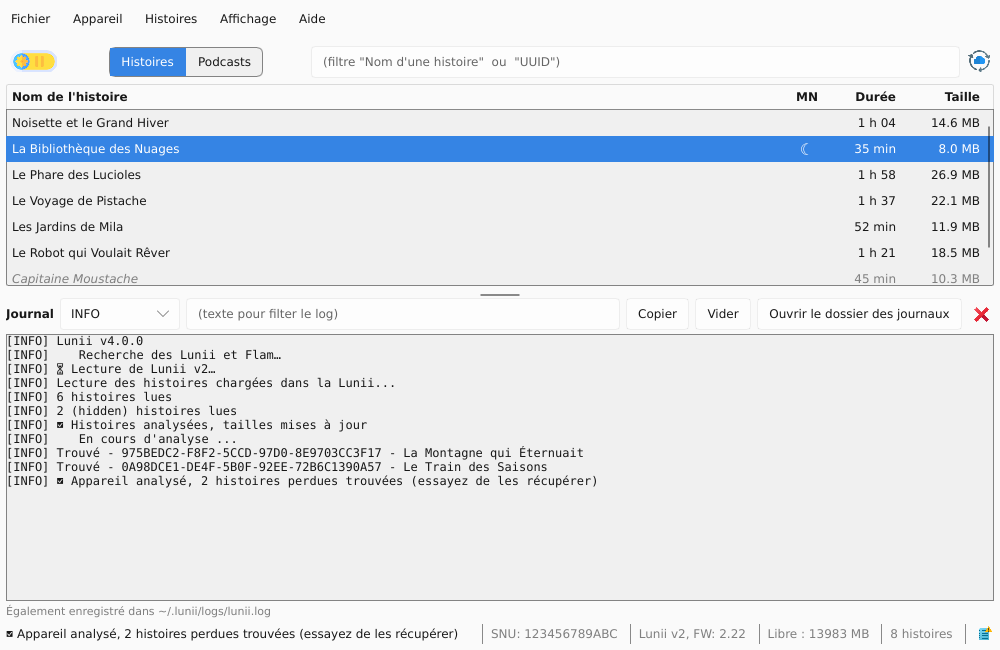
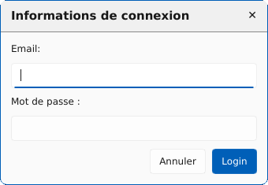

[](https://github.com/o-daneel/Lunii.QT/releases/tag/v3.1.4)
[](https://github.com/o-daneel/Lunii.QT/releases/tag/v3.0.0)
[](https://github.com/o-daneel/Lunii.QT/releases/tag/v2.7.6)

:uk: [English README](./README_EN.md) :uk:

> ℹ️ **Ce dépôt est un fork** de [Lunii.QT](https://github.com/o-daneel/Lunii.QT), le projet d'origine d'o-daneel. L'application y a été réécrite en Rust avec une interface Slint, et enrichie (albums MP3, podcasts…). Merci à o-daneel et aux contributeurs du projet d'origine.

# Lunii

Une application (Rust, interface Slint) pour gérer sa fabrique à histoires (fah) <u>Lunii</u> et <u>Flam</u>, avec les opérations de  **organisation** / **importation** / **exportation** / **téléchargement du firmware**   
pour Windows 11 / MacOs (11 BigSur => 26 Tahoe) / Linux   
(compatible avec les archives STUdio, **avec** support de la conversion audio)
> **FAQ :** Veuillez consulter les questions déjà posées dans la section [Discussions](https://github.com/o-daneel/Lunii.QT/discussions), ou les [Issues](https://github.com/o-daneel/Lunii.QT/issues?q=is%3Aissue%20label%3A%22good%20first%20issue%22) pertinentes.

# Nouveautés
*  😎 **Flam support** 😎  
L'application permet désormais d'importer les histoires Lunii sur votre Flam, sous réserve qu'elle soit en firmware v2.x.x  
    > **Attention :** la Flam est TRES lente en usb. Il faut etre patient. (environ 4min pour 80Mo)

* 😎 **Lunii v3 & Firmware 3.2.x** 😎  
Lunii a été mis à jour pour prendre en charge le dernier firmware (3.2.2 et suivants). Grâce à une analyse approfondie (j’aurais dû connecter les neurones et réfléchir 10 minutes de plus à la premère analyse), une solution **stable** et **TRÈS simple** a été trouvée.  
Oubliez toutes les anciennes manipulations concernant les fichiers .md et le firmware.
  > **Rappel :** Gardez précieusement vos fichiers firmware v3 (vous pourrez toujours rétrograder) et évitez les mises à jour automatiques.

### Matériels pris en charge :
* **Fah v1** et **v2** (support complet)
* **Fah v3** (fichiers md v6 et v7 supportés, sauvegardes personnelles uniquement)
* **Flam** (support complet, sauvegardes personnelles uniquement)

### Limitations :
* L'application <u>n'autorise plus</u> d'exporter les histoires officielles pour les Lunii, à cause du piratage.  
Les Flams <u>pourront</u> sauvegarder et restaurer leurs histoires mais ne fonctionneront que sur le device d'origine.


### Table des matières
<!-- TOC -->
- [Lunii](#lunii)
  - [Interface Utilisateur](#interface-utilisateur)
    - [Fenêtre principale](#fenêtre-principale)
    - [Mode Nuit](#mode-nuit)
  - [Podcasts](#podcasts)
    - [Rechercher et suivre un podcast](#rechercher-et-suivre-un-podcast)
    - [Ajouter des épisodes sur l'appareil](#ajouter-des-épisodes-sur-lappareil)
    - [Supprimer des épisodes](#supprimer-des-épisodes)
    - [Ne plus suivre un podcast](#ne-plus-suivre-un-podcast)
  - [Raccourcis clavier](#raccourcis-clavier)
  - [Fonctionnalités](#fonctionnalités)
  - [Transcodage audio](#transcodage-audio)
  - [Mise à jour du firmware](#mise-à-jour-du-firmware)
  - [Formats d'archives pris en charge](#formats-darchives-pris-en-charge)
    - [pour Lunii](#pour-lunii)
    - [pour Flam](#pour-flam)
  - [Compilation](#compilation)
    - [Préparation de l'environnement](#préparation-de-lenvironnement)
    - [Génération des UI](#génération-des-ui)
    - [Génération des fichiers de tranduction](#génération-des-fichiers-de-tranduction)
    - [Génération du fichier de ressource](#génération-du-fichier-de-ressource)
    - [Exécution](#exécution)
    - [Générer un exécutable GUI](#générer-un-exécutable-gui)
  - [Astuces](#astuces)
    - [macOS - Authorisation de l'application](#macos---authorisation-de-lapplication)
    - [Métadonnées des histoires non-officielles](#métadonnées-des-histoires-non-officielles)
    - [Gestion du cache](#gestion-du-cache)
    - [Dépendances manquantes sous Linux](#dépendances-manquantes-sous-linux)
    - [Exportation V3](#exportation-v3)
    - [Création de l'ICO](#création-de-lico)
  - [Remerciements](#remerciements)
- [Liens / Dépôts similaires](#liens--dépôts-similaires)
<!-- TOC -->

## Interface Utilisateur

<br> 

<br>  
<br>  
 

### Fenêtre principale

  

1. La **barre de menu**. Elle vous informera lorsqu'une mise à jour de l'application est disponible  
   (il suffit d'aller dans Menu About/Update to v2.X.X)
2. Les vues **Histoires** et **Podcasts**.  
   La Lunii/Flam connectée se choisit dans le menu **Appareil**, qui relance aussi la détection (Rafraichir les appareils). Son emplacement et ses informations techniques sont dans Fichier / Informations sur l'appareil, ou d'un clic sur la barre d'état.
3. Gestion du **Mode nuit** ([ici](#mode-nuit)), affichée seulement si la Lunii branchée le gère (Flam exclue)
4. Actualisation de la **base de données Officielle** : Met à jour la liste des histoires et leurs descriptions depuis le Luniistore. Utilisez ce bouton lorsque certaines histoires officielles ne sont pas reconnues.
5. La **liste de vos histoires** avec leur durée. Le menu **Affichage** permet d'afficher aussi leur taille, le mode nuit (MN), leur base de données (DB) et leur UUID, masqués par défaut.  
   L'UUID : Un identifiant unique permettant de lier les histoires à leur dossier sur la Lunii/Flam. Les huit derniers caractères de l'UUID composent le nom du dossier de l'histoire.

   **DB** signifie **Base de données**. Cette application prend en charge deux bases de données différentes
     - **O** - Base de données **O**fficielle de Lunii  
        (Toutes les métadonnées proviennent des serveurs de Lunii).
     - **T** - base de données **T**ierce, également connue sous Non officielles ou Custom  
        (Ces métadonnées ne peuvent pas être récupérées, elles sont complétées lors de l'importation de l'histoire)
6. La colonne **MN** (☾) indique que **l'histoire supporte le Mode Nuit**. Masquée par défaut, elle s'affiche par Affichage / Afficher le mode nuit (MN), sur une Lunii qui le gère. Il est possible de forcer ce status depuis le menu contextuel
7. **Histoires cachées** (les entrées grisées dans la liste).   
   Cette fonctionnalité est activable par le biais du menu contextuel sur une histoire.  
   Son usage est double:  
   1. Masquer certaines histoires pour éviter que l'enfant ne passe trop de temps à sélectionner une histoire le soir. Cela évite de la supprimer et la recopier de nouveau.  
   2. Eviter la suppresion d'histoires non officielles pendant une synchronisation avec l'application Luniistore. Les histoires cachées sont toujours physiquement présente dans l'appareil, mais ne seront pas visible par Luniistore. N'oubliez pas de bien "cacher" vos histoires avant de cliquer sur "synchroniser" !
8. Dans la **barre d'état**, vous trouverez  
   * Votre SNU (numéro de série),
   * La version du firmware de votre Lunii/Flam
   * L'espace disponible sur la SD
   * Le nombre d'histoires


### Mode Nuit
  

## Podcasts

La vue **Podcasts** (bouton en haut de la fenêtre, ou Histoires / Importer un podcast, `Ctrl+P`) met les épisodes d'un podcast sur la Lunii/Flam. À gauche, les podcasts suivis ; à droite, les épisodes de celui qui est sélectionné.

### Rechercher et suivre un podcast
1. Cliquez sur **+** au-dessus des **Podcasts suivis**. La fenêtre **Ajouter un podcast** s'ouvre.
2. Tapez dans le champ, puis Entrée ou **Rechercher** :
   * le **nom** du podcast : il est cherché dans le catalogue Apple Podcasts. Cliquez sur le bon résultat.  
     Les résultats grisés (« flux non public ») ne peuvent pas être chargés ainsi : collez plutôt l'adresse de la page du podcast ;
   * ou son **adresse** : flux RSS, page web du podcast (par exemple une série sur radiofrance.fr) ou lien Apple Podcasts.
3. Le podcast est chargé et vérifié (titre, nombre d'épisodes), puis cliquez sur **Suivre**.

Les podcasts suivis sont rechargés en arrière-plan à chaque ouverture de la vue. Sous chacun, une ligne indique ses **nouveaux épisodes** (en gras) si son album est déjà sur l'appareil, ou son nombre d'épisodes sinon. Le bouton **↻** recharge le podcast sélectionné.  
Un podcast dont l'album est sur l'appareil branché est suivi automatiquement (album importé depuis un autre ordinateur).

### Ajouter des épisodes sur l'appareil
1. Choisissez le podcast à gauche.
2. Choisissez le mode d'import, **Importer comme :**
   * **un album** (par défaut) : une seule histoire, un épisode par piste dans l'ordre chronologique, avec un menu pour choisir l'épisode. Si l'album est déjà sur l'appareil, les épisodes choisis y sont **ajoutés** ;
   * **une histoire par épisode** : chaque épisode apparaît comme une histoire à part dans la liste de l'appareil.
3. Cochez les épisodes voulus (mention **à importer**). Le champ de filtre et les boutons **Tous** / **Aucun** aident à choisir ; un clic sur l'en-tête d'une colonne trie la liste (titre, durée, date de publication, présence sur l'appareil).
4. Cliquez sur **Importer (n)**. Le journal affiche la progression.

Les épisodes déjà sur l'appareil sont cochés dans la colonne **Sur l'appareil**. Les épisodes qui ne sont pas en MP3 sont convertis, et l'option Histoires / **Égaliser le volume (albums, podcasts)** ramène toutes les pistes au même niveau sonore.

### Supprimer des épisodes
Dans la liste des épisodes, **décochez** un épisode présent sur l'appareil : il passe **à supprimer**. Le bouton devient **Supprimer (n)**, ou **Importer (n) et supprimer (m)** si des épisodes sont aussi cochés. Une confirmation liste les épisodes avant de les supprimer.  
Dans un album, seuls les épisodes dont la piste est reconnue peuvent être retirés ; les autres restent grisés.

### Ne plus suivre un podcast
Sélectionnez-le puis cliquez sur **Ne plus suivre**. Si son album, ou des épisodes importés comme histoires, sont sur l'appareil, l'application demande quoi en faire :
* **Garder sur l'appareil** : le podcast disparaît de la liste, ses épisodes restent sur la Lunii/Flam (mais l'album n'est plus mis à jour) ;
* **Supprimer de l'appareil** : l'album ou les histoires du podcast sont aussi supprimés.

> Les podcasts sont en général destinés à l'écoute privée : ne redistribuez pas les fichiers.

## Raccourcis clavier

| Keys           | Actions                                             |
|----------------|-----------------------------------------------------|
| `Ctrl+Up`      | Déplace la ou les sélection(s) en première position |
| `Alt+Up`       | Déplace la ou les sélection(s) vers le haut         |
| `Alt+Down`     | Déplace la ou les sélection(s) vers le bas          |
| `Ctrl+Down`    | Déplace la ou les sélection(s) en dernière position |
|                |                                                     |
| `Ctrl+I`       | Importe une nouvelle histoire                       |
| `Ctrl+P`       | Ajoute un podcast (vue Podcasts)                    |
| `Ctrl+S`       | Exporte la sélection                                |
| `Ctrl+Shift+S` | Exporte toutes les histoires                        |
| `Ctrl+H`       | Masquer/Démasquer les histoires sélectionnées       |
| `Ctrl+N`       | Forcer le mode nuit d'une histoire                  |
| `Delete`       | Supprime les histoires sélectionnées                |
|                |                                                     |
| `Ctrl+L`       | Ouvre la fenêtre de debug                           |
| `Ctrl+Q`       | Fermer l'application                                |
| `F1`           | À propos de l'application                           |
| `F5`           | Réactualise les appareils                           |

## Fonctionnalités
* Détection automatique des **Mises à jour**
* **Import** / **Export** / **Suppression** des histoires
* Support des archives au format **STUdio**, et **importez la base d'histoire de STUdio**
* **Réorganisez** vos histoires dans votre ordre préféré
* Gérer le **mode nuit**
* **Cachez** les histoires  
  Dans le but de ne pas subir une suppression forcée des histoires non officielles durant la synchronisation avec l'application Luniistore, vous pouvez désormais "cacher" temporairement certaines histoires  
  (tous les fichiers sont conservés sur l'appareil)
* **Histoires perdues**  
  Trois nouveaux outils sont proposés pour gérer vos histoires perdues.   
  (souvent suite à un crash d'une autre application 😜)   
 
  Vous pouvez :
  * les lister  
    _(l'application tentera de réparer les histoires, en particulier les fichiers sur les Lunii v1/v2)_
  * les récupérer (si elles sont saines)
  * les supprimer (**attention, les fichiers seront supprimés**)  
* **Podcasts** : recherchez et suivez vos podcasts, importez leurs épisodes en album ou en histoires (cf. [cette section](#podcasts))
* **Récupération du Firmware** pour votre appareil (cf. [cette section](#mise-à-jour-du-firmware))
  
## Transcodage audio
Certaines histoires tierces utilisent des fichiers non MP3 (OGG, WAV, M4A…) ou des MP3 en stéréo. Lunii ne peut pas les lire tels quels : l'application les convertit en MP3 mono 44,1 kHz pendant l'import.

Cette conversion est intégrée à l'application : **aucun logiciel à installer** (FFMPEG n'est plus nécessaire). Elle reconnaît le MP3, l'AAC/M4A, l'OGG Vorbis, l'Opus, le FLAC et le WAV.

## Mise à jour du firmware

Lunii vous offre la possibilité de sauvegarder la dernière version du Firmware disponible sur les serveurs Lunii. Par extension, ayant le firmware enregistré, il est donc possible de manuellement l'installer sur votre appareil sans avoir à vous connecter au LuniiStore (vous ne perdrez pas vos histoires chargées non officielles). Cette procédure est **manuelle** et **expérimentale** mais jusqu'à présent personne n'a rencontré de problème.

**NOTE 1:** Pensez à garder une sauvegarde du firmware pour Lunii v3 et FLAMs, dans le cas d'une mise à jour qui casserait l'astuce des histoires tierces. <u>Vous serez en mesure de downgrader/revenir en arrière.</u>  
**NOTE 2:** Vous ne pouvez pas choisir la version du firmware. Vous n'obtiendrez que la **dernière version disponible** sur les serveurs de Lunii.


### Guide Pratique - Lunii
1. Récupération du firmware
   1. Sélectionnez une Lunii
   2. Menu **Appareil/Récupérer le firmware**
   3. Vous serez invité à vous connecter  
     

   4. Entrez vos identifiants Luniistore (ils ne sont pas sauvegardés pour des raisons de sécurité).  
   Vous pouvez vérifier ce point ici  
   [`firmware_login` dans lunii-gui/src/app/actions.rs](lunii-gui/src/app/actions.rs) et [`luniistore_get_authtoken` dans lunii-core/src/firmware.rs](lunii-core/src/firmware.rs)  
   
   5. Choisissez un emplacement où sauvegarder votre firmware (deux fichiers pour une Lunii v1)

2. Installation du firmware précédemment sauvegardé
   1. Copiez-le(s) fichier(s) du firmware dans le répertoire racine de votre lunii
   2. Renommez en `fa.bin` (et aussi `fu.bin` pour les Lunii v1)   
    ```
    - 
    |- .contents
    |- .md
    |- .pi
    |- fa.bin
    |- ... (other files)
    ```
   3. Éteindre, rallumer, la lunii fait sa mise à jour avec le fichier détecté, attendre : **TADA**  
   (si vous reconnectez votre lunii sur votre pc, le `fa.bin` devrait avoir été supprimé indiquant que la mise à jour est ok et évitant de la refaire au prochain démarrage de la lunii)
   

### Guide Pratique - Flam
1. Récupération du firmware
   1. Sélectionnez votre Flam dans la liste des appareils
   2. Menu **Appareil/Récupérer le firmware**
   3. Vous serez invité à vous connecter  
     

   4. Entrez vos identifiants Luniistore (ils ne sont pas sauvegardés pour des raisons de sécurité).  
   Vous pouvez vérifier ce point ici  
   [`firmware_login` dans lunii-gui/src/app/actions.rs](lunii-gui/src/app/actions.rs) et [`luniistore_get_authtoken` dans lunii-core/src/firmware.rs](lunii-core/src/firmware.rs)  
   
   5. Choisissez un emplacement où sauvegarder vos firmwares (`update-main.enc` and `update-comm.enc`)

2. Installation du firmware précédemment sauvegardé
   1. Copiez-le(s) fichier(s) du firmware dans le répertoire racine de votre Flam    
   ```
   - 
   |- etc/
   |- str/
   |- .mdf
   |- update-main.enc
   |- update-comm.enc
   |- ... (other files)
   ```
   2. Créer un fichier vide `cable_update_complete` dans /tmp
   ```
   - 
   |- etc/
   |- str/
   |- .mdf
   |- update-main.enc
   |- update-comm.enc
   |- tmp/
   |- cable_update_complete
   |- ... (other files)
   ```
   3. Éteindre, rallumer, attendre : **TADA**  
   (si vous reconnectez votre lunii sur votre pc, les `*.enc` devraient avoir été supprimés)
   
## Formats d'archives pris en charge
### pour Lunii
#### .plain.pk [TYPE_LUNII_PLAIN]
**Filename** :  `story_name.8B_UUID.plain.pk`  
**Ciphering** : None / Plain  
**Structure** :  

      _thumbnail.png
      _metadata.json
      uuid.bin
      ni
      li.plain
      ri.plain
      si.plain
      rf/000/XXYYXXYY.bmp
      sf/000/XXYYXXYY.mp3

#### .v1.pk / .v2.pk [TYPE_LUNII_V2_ZIP]
**Filename** :  
* `LONG_UUID.v2.pk`  
* `LONG_UUID.v2.pk`  
* `LONG_UUID.pk`  
  
**Ciphering** : Generic Key  
**Structure** :  

      00000000000000000000000000000000/ni
      00000000000000000000000000000000/li
      00000000000000000000000000000000/ri
      00000000000000000000000000000000/si
      00000000000000000000000000000000/rf/000/XXYYXXYY
      00000000000000000000000000000000/sf/000/XXYYXXYY

#### Alternate Lunii archive (ZIP / 7z) [TYPE_LUNII_V2_ZIP/TYPE_LUNII_V2_7Z]
**Filename** :  `AGE+] story_title DASHED_UUID.zip .7z`  
**Ciphering** : Generic Key  
**Structure** : (same as [.v1.pk / .v2.pk](#v1pk--v2pk))

      00000000-0000-0000-0000-000000000000/ni
      00000000-0000-0000-0000-000000000000/li
      00000000-0000-0000-0000-000000000000/ri
      00000000-0000-0000-0000-000000000000/si
      00000000-0000-0000-0000-000000000000/rf/000/XXYYXXYY
      00000000-0000-0000-0000-000000000000/sf/000/XXYYXXYY

#### STUdio (ZIP / 7z) [TYPE_STUDIO_ZIP/TYPE_STUDIO_7Z]
**Filename** : `AGE+] story_title DASHED_UUID.zip .7z`  
**Ciphering** : None  

**Structure** :  

        assets/
        story.json
        thumbnail.png
      
### pour Flam
**NOTE :** Le format des histoires de la Flam reste inconnu. Seul les sauvegardes personnelles sont supportées
#### Sauvegarde personnelle (ZIP / 7z) [TYPE_FLAM_ZIP/TYPE_FLAM_7z]
**Filename** :  `story_name.8B_UUID.zip`  
**Ciphering** : Story Key (unknown)  
**Structure** :  

      00000000-0000-0000-0000-000000000000/info
      00000000-0000-0000-0000-000000000000/main.lsf
      00000000-0000-0000-0000-000000000000/version
      00000000-0000-0000-0000-000000000000/key
      00000000-0000-0000-0000-000000000000/img/*.lif
      00000000-0000-0000-0000-000000000000/img/script/*.lif
      00000000-0000-0000-0000-000000000000/script/*.lsf
      00000000-0000-0000-0000-000000000000/sounds/*.mp3
      00000000-0000-0000-0000-000000000000/sounds/*.mp3map

## TODO
* Fichier de configuration pour sauvegarder la configuration du menu (tailles / détails)
* Ajout d'une image à la liste des arbres ?

## Compilation

L'application est écrite en Rust (interface [Slint](https://slint.dev)). Le guide de
développement, [`CONTRIBUTING.md`](CONTRIBUTING.md), décrit les prérequis, la
compilation, les vérifications avant de pousser, les variables d'environnement
utiles et la génération des traductions.

Il faut Rust, dans la version fixée par [`mise.toml`](mise.toml).
[mise](https://github.com/jdx/mise) est facultatif : `mise install` installe
cette version (et rustfmt, clippy) ; sinon, une toolchain Rust installée avec
rustup suffit.

```bash
mise install            # facultatif
cargo build --release
./target/release/lunii
```

## Astuces

### macOS - Authorisation de l'application
1. Double cliquez sur le fichier `lunii`.
2. Vous devez voir apparaître le message d'erreur suivant :     
  
  Cliquez sur "**OK**"
3. Allez dans **Préférences du système** > **Sécurité et confidentialité** et cliquez sur l'onglet **Général**.  

4. En bas de la fenêtre, vous trouverez un message indiquant que  `lunii` est bloqué. Cliquez sur "**Ouvrir quand même**".   
   Si vous ne voyez pas ce message sur l'onglet Général, double cliquez de nouveau sur `lunii`.  
   **NOTE :** Il est possible que vous deviez en premier cliquer sur le bouton "**unlock**" puis entrer votre nom d'utilisateur / mot de passe pour pouvoir cliquer sur "**Ouvrir quand même**".
5. Une nouvelle popup apparait       
  
Cliquez sur "**Ouvrir**".   
Si vous n'avez pas eu cette popup, retournez juste double cliquer sur le fichier.
1. Pour finir, un dernier message vous informera de la sorte       
  
Cliquez sur "**Ouvrir**", et vous n'aurez plus ces avertissements à l'avenir. 

### Métadonnées des histoires non-officielles
Lors de l'utilisation de cette application, vous allez peut-être constater des hisoires marquées `Unknown story (maybe a User created story)...`. 
Il s'agit certainement d'une histoire tierce qui a été chargé par une autre application. Lunii n'a donc 
pas connaissance des métadonnées associées (Titre, Description, Image).  
Il est possible de pallier ce problème de deux manières (au choix) :
1. en important la base d'histoires de STUdio avec le menu `File/Import STUdio DB`
2. en glissant déposant l'archive de l'histoire dans l'application, comme pour la charger. Cette dernière étant déjà présente, Lunii ne va faire qu'**analyser les métadonnées** et les ajouter dans la base interne, en prenant soin de **ne pas recharger** l'histoire.

### Gestion du cache
Cette application téléchargera une fois pour toutes la base de données des histoires officielles et toutes les images demandées dans le dossier dédié à l'application.
* `$HOME/.lunii/official.db`
* `$HOME/.lunii/cache/*`

En cas de problème, il suffit de supprimer ce fichier et ce répertoire pour forcer le rafraîchissement.


### Dépendances sous Linux
L'interface a seulement besoin des bibliothèques graphiques d'un bureau standard
(X11 ou Wayland, xkbcommon, fontconfig), déjà présentes sur les distributions
courantes. Les boîtes de dialogue d'ouverture de fichiers passent par
`xdg-desktop-portal`. Si elles ne s'ouvrent pas, installez le portail de votre
bureau (par exemple `xdg-desktop-portal-gtk` ou `xdg-desktop-portal-kde`).

Pour compiler l'application, voir les prérequis dans [`CONTRIBUTING.md`](CONTRIBUTING.md#prérequis).

### Exportation V3
Afin de supporter l'exportation d'histoires depuis une Luniis v3, vous devez placer vos clés de périphérique ici :
```bash
%HOME%\.lunii\230230300XXXXX.keys
$HOME/.lunii/230230300XXXXX.keys
```
Il s'agit d'un fichier binaire avec 0x10 octets pour la clé et 0x10 octets pour l'IV.

### Création de l'ICO
```bash
magick convert logo.png -define icon:auto-resize="256,128,96,64,48,32,16"  logo.ico
```

## Remerciements
Merci à :
* **olup** pour l'aide sur le format des archives STUdio  
* **sniperflo** pour le support de la v1 & debug 
* **McFlyPartages** pour le debug sous Linux et ses contributions 
*  ceux que j'oublie.... 👍

# Liens / Dépôts similaires
* [Lunii v3 - Reverse Engineering](https://github.com/o-daneel/Lunii_v3.RE)
* [Lunii CLI tool](https://github.com/o-daneel/Lunii.PACKS)
* [STUdio - Story Teller Unleashed](https://marian-m12l.github.io/studio-website/)
* [(GitHub) STUdio, Story Teller Unleashed](https://github.com/marian-m12l/studio)
* [Lunii Admin](https://github.com/olup/lunii-admin) (Une alternative en Go de STUdio)
* [Lunii Admin Web](https://github.com/olup/lunii-admin-web) (même chose que précédemment, mais à partir d'un navigateur)
* Astuce de l'icone dans le workflow avec  **[rcedit](https://github.com/electron/rcedit)**
