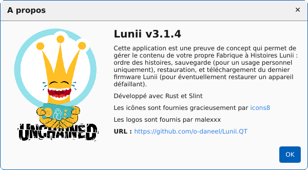
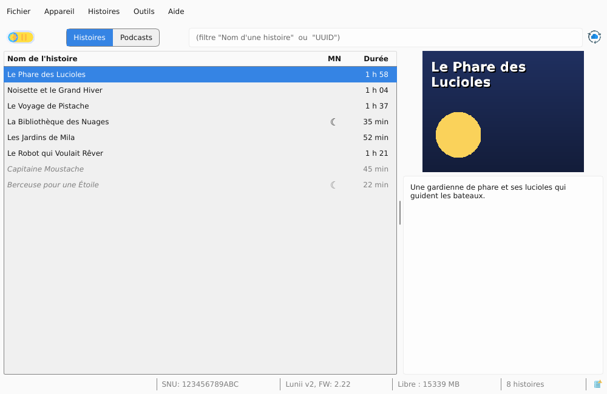
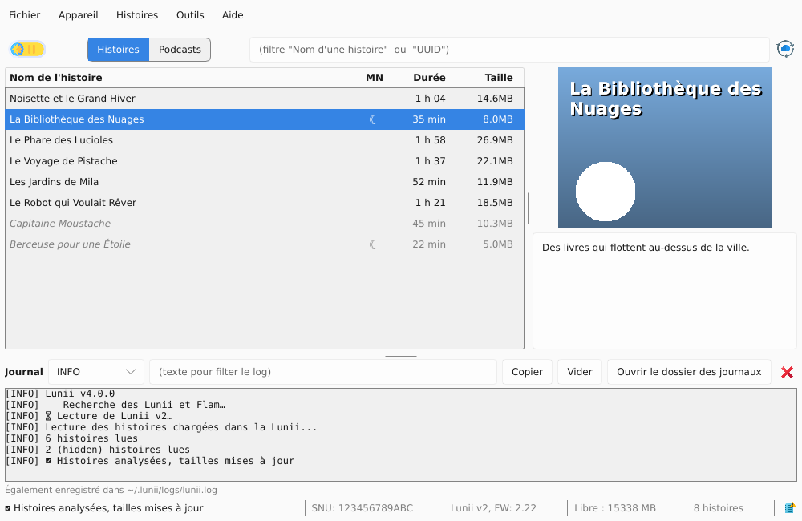
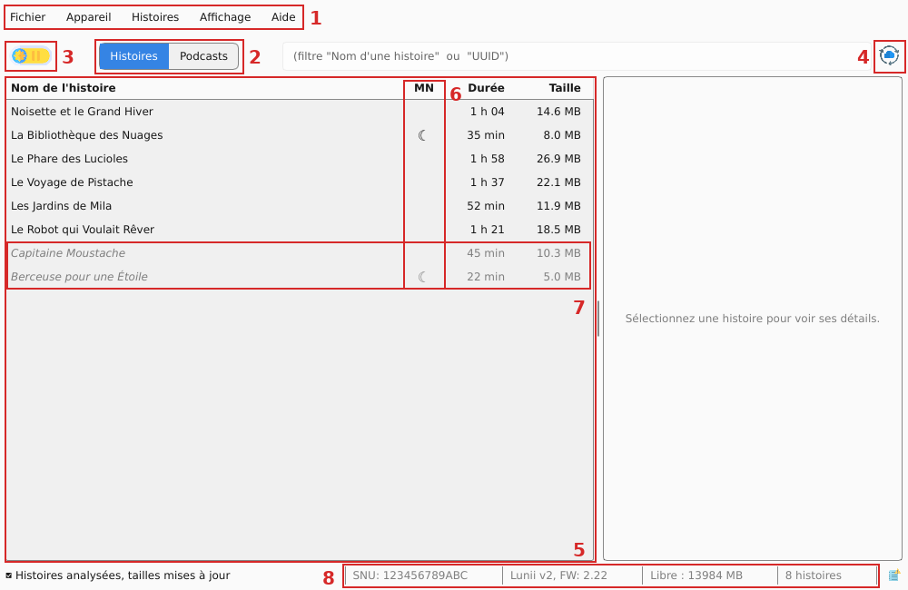
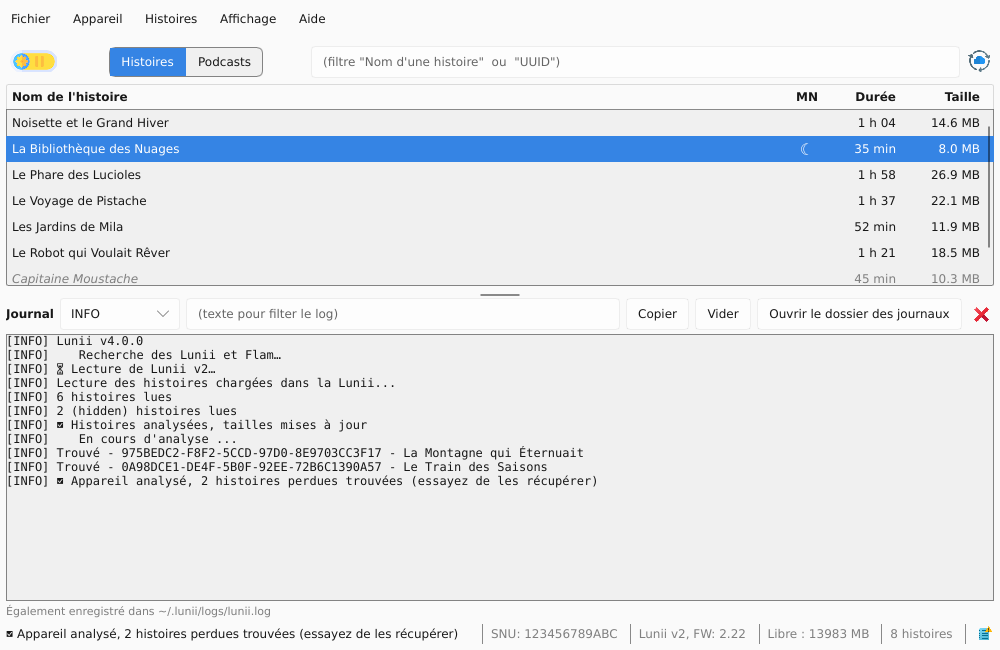
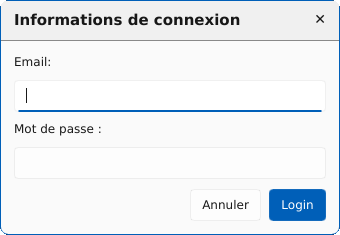

[](https://github.com/o-daneel/Lunii.QT/releases/tag/v3.1.4)
[](https://github.com/o-daneel/Lunii.QT/releases/tag/v3.0.0)
[](https://github.com/o-daneel/Lunii.QT/releases/tag/v2.7.6)

:fr: [README en français](README.md) :fr:

> ℹ️ **This repository is a fork** of [Lunii.QT](https://github.com/o-daneel/Lunii.QT), the original project by o-daneel. The app has been rewritten in Rust with a Slint UI, and extended (MP3 albums, podcasts…). Thanks to o-daneel and the contributors of the original project.

# Lunii
An app (Rust, Slint UI) to manage <u>Lunii</u> and <u>Flam</u> Storytellers, including **reorder** / **import** / **export** / **hide** / **firmware download**   
for Windows 11 / MacOs (11 BigSur => 26 Tahoe) / Linux   
(compatible with STUdio archive, **with** transcoding)

> **FAQ :** Please refer to already asked questions on [Discussions](https://github.com/o-daneel/Lunii.QT/discussions) section, or refer to revelant [Issues](https://github.com/o-daneel/Lunii.QT/issues?q=is%3Aissue%20label%3A%22good%20first%20issue%22)

# Breaking news
* 😎 **Flam support** 😎  
The application now allows importing Lunii stories onto your Flam, provided it is running firmware v2.x.x.  
   > **Warning:** the Flam is VERY slow over USB. Please be patient. (around 4min for 80MB)

* 😎 **Lunii v3 & Firmware 3.2.x** 😎  
Lunii has been updated to support the latest firmware (3.2.2 and later). Thanks to a longer analysis (I should have spent 10 more minutes at the first sight to connect neurons), **a stable** and **VERY simple** workaround has been found.  
Forget about all previous .md and firmware recommendations.
   > **Reminder:** Keep your v3 Firmware files safe (you can always downgrade) and keep away from automatic upgrades

### Hardware supported:
* **v1, v2**  (full Support)
* **v3**  (v6 and v7 md files supported 💪🏻, personal backup only)  
* **Flam** (full Support, personal backup only)

### Limitations
* Application <u>no longer</u> allows Lunii Official stories to be exported (due to piracy)  
  Flam devices <u>can</u> back up and restore their stories, but they will only work on the original device.

### Table of contents
<!-- TOC -->
- [Lunii](#lunii)
  - [User Interface](#user-interface)
    - [Main window](#main-window)
    - [Night mode](#night-mode)
  - [Shortcuts](#shortcuts)
  - [Features](#features)
  - [Audio Transcoding](#audio-transcoding)
  - [Firmware upgrade](#firmware-upgrade)
  - [Supported archive formats](#supported-archive-formats)
    - [for Lunii](#for-lunii)
    - [for Flam](#for-flam)
  - [Building](#building)
    - [Prepare env](#prepare-env)
    - [Build UI files](#build-ui-files)
    - [Build Translation files](#build-translation-files)
    - [Build resource files](#build-resource-files)
    - [Run](#run)
    - [Build GUI executable](#build-gui-executable)
  - [Tricks](#tricks)
    - [macOS - Application Authorization](#macos---application-authorization)
    - [Third Party story metadata](#third-party-story-metadata)
    - [Cache management](#cache-management)
    - [Linux missing dependencies](#linux-missing-dependencies)
    - [v3 export](#v3-export)
    - [ICO creation](#ico-creation)
  - [Credits](#credits)
- [Links / Similar repos](#links--similar-repos)
<!-- TOC -->


## User Interface

<br>  
  
<br>    
<br>  
 

### Main window

  

1. The **menu bar**. It will notify you when an update is available  
   (just get it with Menu About/Update to v2.X.X)
2. The **model of your Lunii/Flam** when it's connected (its location and technical details are in File / Device information, or a click on the status bar).   
   The button on the left updates automatic detection.
3. Configuring **Night mode** ([here](#night-mode))
4. **Official DB refresh** : Updates the list of stories and related information from the official Lunii Store. Use it when some official are not recognized.
5. The **list of your stories** with their duration. The **Tools** menu also shows their size, Database (DB) origin and UUID, hidden by default.  
   The UUID: This unique identifier allows you to associate stories with their folder on the Lunii, thanks to the last eight characters that make up the name of the folder associated with that story.

   * **DB** stands for **Database**. This application supports two different databases
     - **O** - Lunii **O**fficial Database  
        _(all metadata are fed from Lunii servers)_
     - **T** - **T**hirdparty Database, also known as Unofficial or Custom Stories  
        _(Those metadata can't be fetched. They are completed upon story import)_

6. The 🛏️ icon indicates that **the story supports Night Mode**. You can force this status from the context menu.

7. **Hidden stories** (the greyed-out entries in the list).  
   This feature can be activated via the context menu on a story.  
   It has two uses:  
   1. Hide certain stories to prevent the child from spending too much time choosing a story at night. This avoids having to delete and copy them again later.  
   2. Prevent the deletion of unofficial stories during synchronization with the Luniistore application. Hidden stories are still physically present on the device, but will not be visible to Luniistore. Don't forget to "hide" your stories before clicking "synchronize"!

8. The **status bar**, you'll find 
   * your SNU (serial number)
   * the firmware version of your Lunii/Flam
   * the available space  
   * the number of stories it contains

### Night mode
  

## Shortcuts

| Keys           | Actions                          |
|----------------|----------------------------------|
| `Ctrl+Up`      | Move the selected item(s) Top    |
| `Alt+Up`       | Move the selected item(s) Up     |
| `Alt+Down`     | Move the selected item(s) Down   |
| `Ctrl+Down`    | Move the selected item(s) Bottom |
|                |                                  |
| `Ctrl+I`       | Import new story                 |
| `Ctrl+S`       | Export the selection             |
| `Ctrl+Shift+S` | Export all the stories           |
| `Ctrl+H`       | Hide/Show selected stories       |
| `Ctrl+N`       | Force NightMode on stories       |
| `Delete`       | Remove the selected item(s)      |
|                |                                  |
| `Ctrl+L`       | Open debug log window            |
| `Ctrl+Q`       | Exit the application             |
| `F1`           | About the app                    |
| `F5`           | Refresh devices                  |

## Features
* Automatic **Update** detection
* **Import** / **Export** / **Remove** stories
* Support **STUdio** archive formats, and **import STUdio database**
* **Reorganize** the stories in the order you want
* **Hide** stories  
  In order to avoid stories to get removed by Luniistore PC Synchronization, you can temporary hide them (all files ares kept on device), sync, and revert hide.
* **Lost Stories**  
  Three tools are offered to manage "crashed" stories on your device.   
 
  You can :
  * List them  
  _(app will try to fix broken stories, in particular auth files on v1/v2)_
  * Recover them (if they are complete)
  * Remove them (**be careful, files will be deleted**)  
* **Get Firmware**  for your device (refer [this section](#firmware-upgrade))

## Audio Transcoding
Some third-party stories use non MP3 files (OGG, WAV, M4A…) or stereo MP3 files. Lunii can't play them as they are: the application converts them to mono 44.1 kHz MP3 during the import.

This conversion is built into the application: **nothing to install** (FFMPEG is no longer needed). It reads MP3, AAC/M4A, OGG Vorbis, Opus, FLAC and WAV.

## Firmware upgrade

Lunii allows you to backup the latest firmware version available from Lunii servers. With your firmware backed up, you can manually install it on your device without connecting to LuniiStore (you will not lose your loaded unofficial stories). This procedure is **manual** and **experimental**, but so far no one has reported any issues.

**NOTE 1:** Remember to keep a backup of your firmware for Lunii v3 and FLAMs, in case a future update breaks the third-party stories workaround. <u>You will be able to downgrade.</u>  
**NOTE 2:** You cannot choose the firmware version. You'll only get the **latest available version** from Lunii servers.

### HowTo - Lunii
1. Firmware retrieval  
   1. Select a Lunii/Flam device
   2. Menu **Tools/Advanced/Get FW Update**
   3. You'll be prompted for login entry  
     

   4. Enter your Luniistore credentials (they are not saved for security purpose).  
      You can verify this point here
      [`firmware_login` in lunii-gui/src/app/actions.rs](lunii-gui/src/app/actions.rs) and [`luniistore_get_authtoken` in lunii-core/src/firmware.rs](lunii-core/src/firmware.rs)  
      
   5. Pick a location where to save your firmware(s) (there are two for Lunii v1)

2. Installing the previously backed up firmware
   1. Copy it to the root dir of your device
   2. Rename it to `fa.bin` (and optionnally  `fu.bin` for Lunii v1)   
   ```
   - 
   |- .contents
   |- .md
   |- .pi
   |- fa.bin
   |- ... (other files)
   ```
   3. Power OFF, Power ON, Wait : **TADA**  
   (if you reconnect your lunii on your pc, the `fa.bin` should have been removed)


### HowTo - Flam
1. Firmware retrieval  
   1. Select a Flam device
   2. Menu **Tools/Advanced/Get FW Update**
   3. You'll be prompted for login entry  
     

   4. Enter your Luniistore credentials (they are not saved for security purpose).  
      You can verify this point here
      [`firmware_login` in lunii-gui/src/app/actions.rs](lunii-gui/src/app/actions.rs) and [`luniistore_get_authtoken` in lunii-core/src/firmware.rs](lunii-core/src/firmware.rs)  
      
   5. Pick a location where to save your firmwares (`update-main.enc` and `update-comm.enc`)

2. Installing the previously backed up firmware
   1. Copy them to the root dir of your device   
   ```
   - 
   |- etc/
   |- str/
   |- .mdf
   |- update-main.enc
   |- update-comm.enc
   |- ... (other files)
   ```
   2. Create an empty file `cable_update_complete` in /tmp
   ```
   - 
   |- etc/
   |- str/
   |- .mdf
   |- update-main.enc
   |- update-comm.enc
   |- tmp/
   |- cable_update_complete
   |- ... (other files)
   ```
   3. Eject USB from Flam device (USB cable must be kept connected) and update process will start : **TADA**  
   (if you reconnect your flam on your pc, the `*.enc` should have been removed)

## Supported archive formats
### for Lunii
#### .plain.pk [TYPE_LUNII_PLAIN]
**Filename** :  `story_name.8B_UUID.plain.pk`  
**Ciphering** : None / Plain  
**Structure** :  

      _thumbnail.png
      _metadata.json
      uuid.bin
      ni
      li.plain
      ri.plain
      si.plain
      rf/000/XXYYXXYY.bmp
      sf/000/XXYYXXYY.mp3

#### .v1.pk / .v2.pk [TYPE_LUNII_V2_ZIP]
**Filename** :  
* `LONG_UUID.v2.pk`  
* `LONG_UUID.v2.pk`  
* `LONG_UUID.pk`  
  
**Ciphering** : Generic Key  
**Structure** :  

      00000000000000000000000000000000/ni
      00000000000000000000000000000000/li
      00000000000000000000000000000000/ri
      00000000000000000000000000000000/si
      00000000000000000000000000000000/rf/000/XXYYXXYY
      00000000000000000000000000000000/sf/000/XXYYXXYY

#### Alternate Lunii archive (ZIP / 7z) [TYPE_LUNII_V2_ZIP/TYPE_LUNII_V2_7Z]
**Filename** :  `AGE+] story_title DASHED_UUID.zip .7z`  
**Ciphering** : Generic Key  
**Structure** : (same as [.v1.pk / .v2.pk](#v1pk--v2pk))

      00000000-0000-0000-0000-000000000000/ni
      00000000-0000-0000-0000-000000000000/li
      00000000-0000-0000-0000-000000000000/ri
      00000000-0000-0000-0000-000000000000/si
      00000000-0000-0000-0000-000000000000/rf/000/XXYYXXYY
      00000000-0000-0000-0000-000000000000/sf/000/XXYYXXYY

#### STUdio (ZIP / 7z) [TYPE_STUDIO_ZIP/TYPE_STUDIO_7Z]
**Filename** : `AGE+] story_title DASHED_UUID.zip .7z`  
**Ciphering** : None  

**Structure** :  

        assets/
        story.json
        thumbnail.png
      
### for Flam
**NOTE :** The Flam story format is still unknown. Only personal backup are supported.
#### Personnal backup (ZIP / 7z) [TYPE_FLAM_ZIP/TYPE_FLAM_7z]
**Filename** :  `story_name.8B_UUID.zip`  
**Ciphering** : Story Key (unknown)  
**Structure** :  

      00000000-0000-0000-0000-000000000000/info
      00000000-0000-0000-0000-000000000000/main.lsf
      00000000-0000-0000-0000-000000000000/version
      00000000-0000-0000-0000-000000000000/key
      00000000-0000-0000-0000-000000000000/img/*.lif
      00000000-0000-0000-0000-000000000000/img/script/*.lif
      00000000-0000-0000-0000-000000000000/script/*.lsf
      00000000-0000-0000-0000-000000000000/sounds/*.mp3
      00000000-0000-0000-0000-000000000000/sounds/*.mp3map

## Building

The application is written in Rust (UI made with [Slint](https://slint.dev)). The
development guide is [`CONTRIBUTING.md`](CONTRIBUTING.md) (in French), which documents
the prerequisites, the build, the checks to run before pushing, the useful
environment variables and the translation workflow.

```bash
cd rust
cargo build --release
./target/release/lunii
```

## Tricks

### macOS - Application Authorization
1. Double-click the file called `lunii`.
2. You should see an error message "`lunii` can’t be opened because it is from an unidentified developer".  
  
  Click "**OK**"
3. Go to System **Preferences** > **Security** and **Privacy** and click on the General tab.  

4. At the bottom of the window you will see a message saying that `lunii` was blocked. Click "**Open Anyway**".   
   If you do not see this message in the General tab, double-click `lunii` again.  
   **NOTE :** You may have to click the "**unlock**" button and enter your password to be able to click "**Open Anyway**".
8. If you see another popup that says “`lunii` is from an unidentified developer. Are you sure you want to open it?”, click "**Open**". If you don’t get this popup, just go to the same file and double-click it again.    

9. Finally, you'll be informed that `lunii` was downloaded from internet     
  
Click "**Open**", and you'll never get these messages in the future. 

### Third Party story metadata
You might have already loaded non-official stories to your device thanks to another app. When opening Lunii, this 
story will appear as `Unknown story (maybe a User created story)...`.   
You can easily fix that by :  
1. Importing STUdio DB with menu `File/Import STUdio DB`
2. Dropping the corresponding archive as you'll do for loading.  
Lunii will **only read the metadata** and add them locally, **skipping the rest** of the archive.


### Cache management
This application will download once for all the official story database and any request pictures to the application dedicated folder
* `$HOME/.lunii/official.db`
* `$HOME/.lunii/cache/*`

In case of any trouble, just remove this file and directory to force refresh

### Linux dependencies
The application only needs the graphics libraries of a standard desktop (X11 or
Wayland, xkbcommon, fontconfig), already present on common distributions. The
file dialogs go through `xdg-desktop-portal`. If they don't open, install
your desktop's portal (e.g. `xdg-desktop-portal-gtk` or
`xdg-desktop-portal-kde`).

To build the application, see the prerequisites in [`CONTRIBUTING.md`](CONTRIBUTING.md#prérequis) (in French).

### v3 export
In order to suport story export from Lunii v3 hardware, you must place your device keys in here :
```bash
%HOME%\.lunii\230230300XXXXX.keys
$HOME/.lunii/230230300XXXXX.keys
```
It is a binary file with 0x10 bytes for Key and 0x10 bytes for IV
### ICO creation
```bash
magick convert logo.png -define icon:auto-resize="256,128,96,64,48,32,16"  logo.ico
```

## Credits
Thanks to :
* **olup** for STUdio archive format 
* **sniperflo** for v1 support, MacOs support & debug 
* **McFlyPartages** for Linux debug and other contributions 

# Links / Similar repos
* [Lunii v3 - Reverse Engineering](https://github.com/o-daneel/Lunii_v3.RE)
* [Lunii CLI tool](https://github.com/o-daneel/Lunii.PACKS)
* [STUdio - Story Teller Unleashed](https://marian-m12l.github.io/studio-website/)
* [(GitHub) STUdio, Story Teller Unleashed](https://github.com/marian-m12l/studio)
* [Lunii Admin](https://github.com/olup/lunii-admin) (a GO implementation of a STUdio alternative)
* [Lunii Admin Web](https://github.com/olup/lunii-admin-web) (same as previous but from a browser)  
* Icon trick for workflow using **[rcedit](https://github.com/electron/rcedit)**
